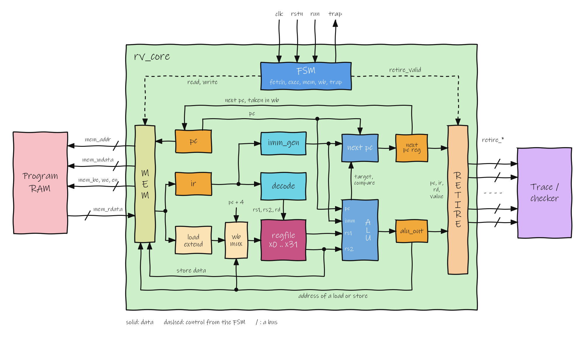

# florv

florv is a rig for validating a RISC-V processor on an FPGA. A small RV32I core
written in VHDL runs in the programmable logic of a Digilent Zybo (Zynq XC7Z010).
The same program runs in a C++ instruction-set simulator (ISS), and a bare-metal
C++ checker on the board's Cortex-A9 compares every instruction the core finishes
with the simulator's result. The first difference names the instruction where the
hardware went wrong.

The core, [`rtl/rv_core.vhd`](rtl/rv_core.vhd), is a multi-cycle processor with a
memory port on one side and a retire port on the other. The retire port reports
each finished instruction (pc, instruction word, register write, memory access),
and that record is what the checker compares with the ISS.

## Parts

| Folder | What it holds |
|---|---|
| `rtl/`, `tb/` | The core in VHDL-2008 and its self-checking testbenches |
| `core/` | The ISS, decoder, memory and ELF loader in C++; the same code builds for the PC and the Cortex-A9 |
| `host/` | `florv`, a command-line tool that runs an ELF in the ISS and writes a trace |
| `arm/` | The bare-metal application for the Zynq processor, where the checker goes |
| `tests/`, `tools/` | RISC-V test programs, unit tests, and scripts that compare the ISS with Spike |

## Status

Work in progress.

- The ISS executes all 40 RV32I instructions and agrees with Spike on eight test
  programs (659 instructions).
- The core passes its testbench in simulation. It has not run on the board yet.
- The lockstep checker, random programs and the RISCOF architecture tests are not
  started.
